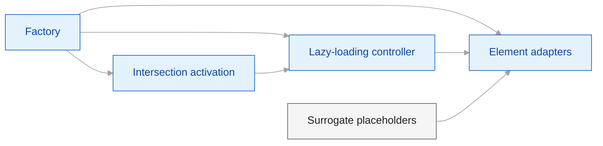
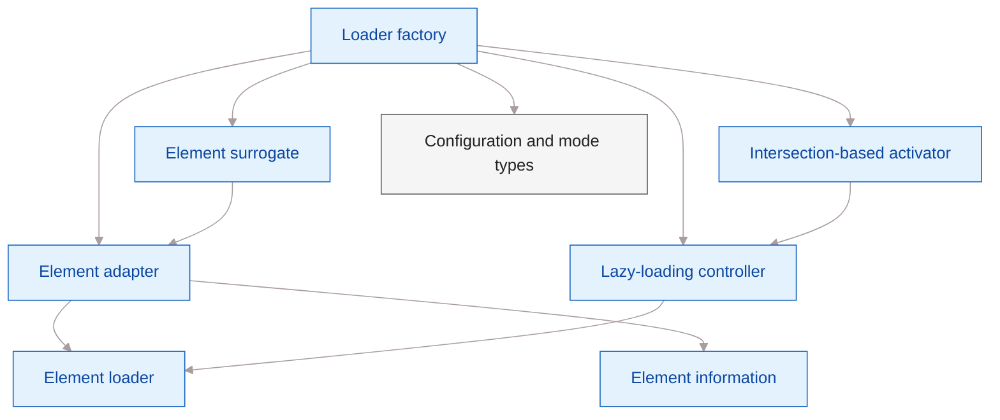
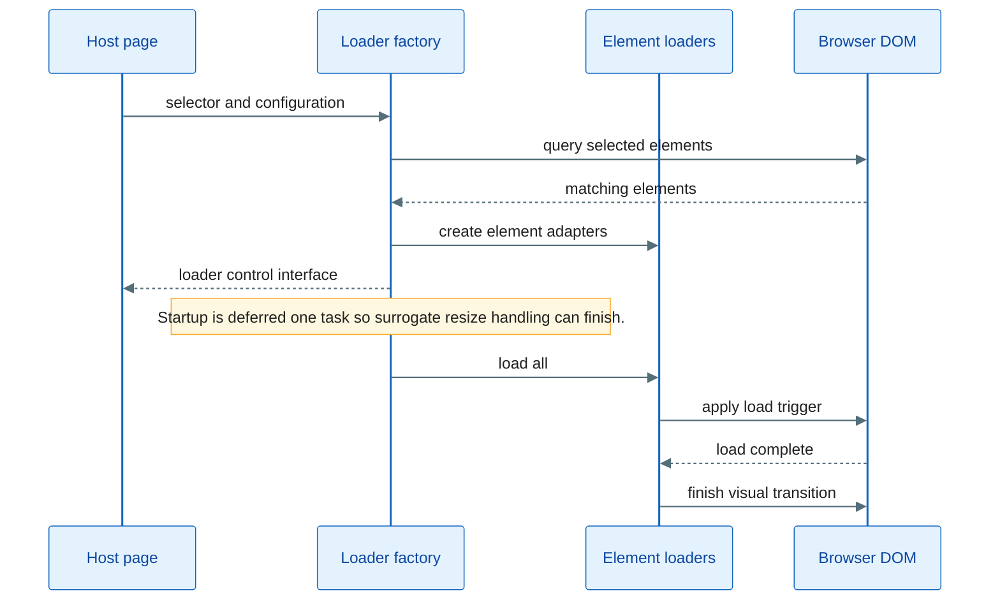
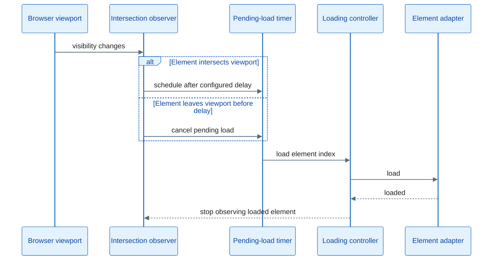
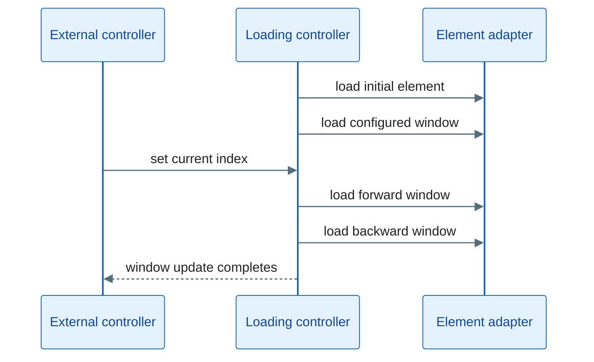
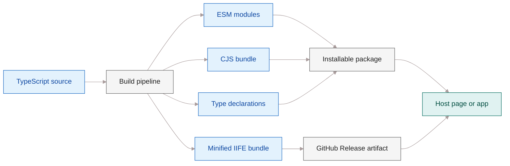

# Mibreit Lazy Loader Architecture

## 1. Introduction and Goals

### 1.1 Purpose

Mibreit Lazy Loader is a TypeScript browser library that defers loading images and
iframes until they are useful to the visitor. It keeps the initial page payload small,
preserves layout stability while media loads, and supports a windowed loading strategy
for galleries and other element sequences.

The library originated from the need for high mobile loading performance on
[www.mibreit-photo.com](https://www.mibreit-photo.com), a photography homepage where
image-heavy galleries would otherwise dominate the initial download.

### 1.2 Scope

The library:

- Finds lazily loaded elements selected by a CSS selector.
- Supports simple deferred loading, externally controlled windowed loading, and
  intersection-driven vertical or horizontal windowed loading.
- Loads media through `data-src` or the browser-native lazy-loading marker workflow.
- Optionally substitutes placeholder elements for dimensions-carrying media to prevent
  layout shifts before loading.
- Ships as ESM, CJS, and IIFE bundles with TypeScript definitions.

The library does not:

- Host, transform, or optimize media assets.
- Provide server-side rendering, caching, or persistence.
- Support legacy browsers beyond the current JavaScript and browser API baseline.

### 1.3 Quality Goals

In priority order:

1. **Loading performance** — minimize impact on initial page load and avoid loading media
   the visitor has not approached.
2. **Small bundle size** — keep the runtime footprint suitable for direct inclusion in
   performance-sensitive websites.
3. **Maintainability** — keep the browser-facing loading responsibilities modular and
   TypeScript-supported.
4. **Modern browser compatibility** — target current browsers without a legacy polyfill
   layer.
5. **Ease of use** — provide a small public API and common defaults for HTML-page
   integration.

Detailed quality scenarios are recorded in [§10](#10-quality-requirements).

### 1.4 Stakeholders

| Stakeholder                 | Interest                                                                               |
| --------------------------- | -------------------------------------------------------------------------------------- |
| Photographer and site owner | Fast, stable media presentation on www.mibreit-photo.com, especially on mobile devices |
| Website developers          | A small, easy-to-integrate lazy loader for HTML pages                                  |
| TypeScript consumers        | A typed ESM API that can be imported directly, including by mibreit-gallery-ts         |
| Site visitors               | Fast initial page display without layout jumps                                         |

## 2. Architecture Constraints

### 2.1 Technical Constraints

- The library runs entirely in the browser; there is no server-side component.
- The implementation is written in TypeScript and compiled with strict type checking.
- The supported browser baseline is the current generation of modern browsers. The
  library does not include a legacy polyfill layer.
- The public API is exposed as ESM, CJS, and IIFE bundles with generated TypeScript
  definitions.
- The library manipulates DOM elements directly through standard browser APIs.
- Build output is generated; source files are the only durable implementation input.

### 2.2 Organizational Constraints

- The project is maintained by a single maintainer, so the architecture prioritizes a
  small, comprehensible codebase and low operational overhead.
- The library must remain directly usable in HTML pages and as a typed ESM dependency
  by the maintainer's other TypeScript projects.

### 2.3 Conventions

- Node package management uses npm.
- Project commands are exposed through Task, with npm scripts used as the underlying
  build and test entry points.
- Generated library output directories are not committed to source control.

## 3. System Scope and Context

Mibreit Lazy Loader is embedded in a host page. It receives a CSS selector and
configuration from the page, finds matching media elements, and changes their attributes
and CSS classes to trigger loading. It has no backend and stores no persistent state.

### 3.1 Responsibilities

- Validate configuration input.
- Discover lazy-loadable elements.
- Track which elements are loaded or pending.
- Trigger media loading according to the selected mode.
- Maintain a window of loaded elements for sequence-based use cases.
- Optionally preserve layout through surrogate placeholder elements.
- Expose loading state and manual control methods to the host page.

### 3.2 Boundaries

The library does not:

- Fetch or transform media assets itself; the browser performs resource loading.
- Provide fallbacks or polyfills for older browsers.
- Persist loading state across page reloads.
- Manage media variants, responsive source selection, or caching.
- Own host-page markup or styling beyond lazy-loading marker and placeholder classes.

## 4. Solution Strategy

The architecture uses a small set of cooperating objects rather than a framework:

1. **Typed public boundary** — a factory validates configuration, creates loader
   components, and returns a stable control interface to the host page.
2. **Element adaptation** — each selected DOM element is wrapped behind loading and
   dimension/location interfaces, isolating DOM mutations from loading policy.
3. **Windowed loading policy** — a lazy-loading controller owns the current element
   index, a configurable left/right loading window, and the set of unloaded elements.
4. **Intersection-driven activation** — scroll modes use an intersection observer to
   identify elements near the viewport and debounce activation until an element remains
   visible for the configured delay.
5. **Layout preservation** — surrogate placeholders occupy the target element's
   dimensions and display a loading indicator until the real element is ready.
6. **Multi-format publication** — one TypeScript source builds a tree-shakeable ESM
   bundle, a CJS bundle, a minified IIFE bundle for HTML pages, and TypeScript
   definitions.

### 4.1 Strategy Rationale

- **Performance:** deferred and intersection-driven loading keeps unnecessary media out
  of the initial payload, which directly supports the mobile speed goal of a
  photography website.
- **Bundle size:** no runtime framework is used; browser-native observation is preferred
  over repeated geometry polling.
- **Layout stability:** explicit surrogates are used because they provide more reliable
  space preservation than relying on media dimensions alone.
- **Maintainability:** loading policy, direct DOM access, viewport activation, and layout
  preservation are separate responsibilities behind narrow interfaces.
- **Integration reach:** one source of truth supports script-tag pages, bundler-based
  JavaScript projects, and typed TypeScript consumers.

## 5. Building Block View

### 5.1 Level 1: Library

The library is one browser-side building block with two public entry points:

- **Selector-based creation** — find elements by CSS selector and initialize lazy
  loading from a configuration object.
- **Element-based creation** — initialize lazy loading from an already-created array of
  element adapters.

Both entry points return the same loader control interface. This lets a plain HTML page
and a TypeScript application such as mibreit-gallery-ts integrate the same behavior.

### 5.2 Level 2: Internal Building Blocks

| Building block               | Responsibility                                                                                                                |
| ---------------------------- | ----------------------------------------------------------------------------------------------------------------------------- |
| Loader factory               | Validate configuration, construct loaders and surrogates, select the startup mode, and defer startup until the page is stable |
| Element adapter              | Wrap a selected DOM element and combine loading, dimension, and location behavior behind interfaces                           |
| Element information          | Read declared element dimensions and original CSS class information                                                           |
| Element loader               | Apply the lazy-loading marker workflow, trigger media loading, and track loading state and callbacks                          |
| Element surrogate            | Preserve the real element's space with a placeholder and loading indicator until loading completes                            |
| Lazy-loading controller      | Maintain the current index, loading window, and unloaded-element indices; expose manual loading controls                      |
| Intersection-based activator | Observe visible placeholders and debounce activation for elements that remain visible                                         |
| Configuration and mode types | Define and validate the public configuration and lazy-loading modes                                                           |

### 5.3 Public Interface

The public TypeScript interface intentionally exposes:

- Loader construction and lazy-loading modes.
- The loader control interface for loading all, loading one element, and moving the
  current window.
- Querying unloaded element indices.
- The element-information interface used for external element collections.
- Core loader and element implementation classes for direct use by dependent projects.

The exact export surface is defined by the package's public entry point. Internal
interfaces and helpers are not public API guarantees.

## 6. Runtime View

### 6.1 Startup and Simple Deferred Loading

In simple deferred mode, all selected elements load after the current task. This mode is
intended for pages where the browser should not begin media loading until normal page
initialization has completed.

### 6.2 Scroll-Based Windowed Loading

Vertical and horizontal scroll modes use the same flow; only the host page layout
differs. If the element leaves the viewport before the delay expires, loading is
cancelled. An already-loading element reports `false`, and a completed element reports
`true`, allowing the caller to distinguish progress without duplicate loading.

### 6.3 Externally Controlled Windowed Loading

This mode gives the host application control over the sequence position. It is intended
for gallery-like consumers that know the current item and want the library to preload a
bounded neighborhood around it.

### 6.4 Surrogate Lifecycle

When surrogates are enabled for a scroll mode:

1. The surrogate wrapper is sized from the real element's declared width and height.
2. The real element remains inside the wrapper but hidden by lazy-loading styling.
3. The intersection observer observes the surrogate, not the real element.
4. When the real element finishes loading, its registered callback removes the loading
   indicator, unwraps the real element, and removes the surrogate.

This lifecycle preserves layout space while an image or iframe loads and restores the
original DOM relationship once it is ready.

## 7. Deployment View

Mibreit Lazy Loader is distributed as a client-side library. There is no service to
deploy, and all runtime execution occurs in the host page's browser environment.

### 7.1 Build and Distribution Artifacts

| Artifact             | Consumers                                            | Purpose                                                |
| -------------------- | ---------------------------------------------------- | ------------------------------------------------------ |
| ESM modules          | Bundler-based JavaScript and TypeScript applications | Direct typed imports and tree shaking                  |
| CJS bundle           | CommonJS consumers                                   | Compatibility with older bundler and Node.js workflows |
| Minified IIFE bundle | HTML pages loaded through a script tag               | Direct browser integration without a module bundler    |
| Type declarations    | TypeScript consumers                                 | Compile-time API checking and editor support           |

### 7.2 Development Environment

- Dependencies are installed with npm.
- Vite serves the local demo pages during development.
- The standard build regenerates all library output directories and declaration files.
- Generated output directories are ignored by Git and are recreated by the package's
  prepare step when the package is installed directly from Git.

### 7.3 Release Flow

The release process:

1. Verifies that the requested semantic version is higher than the current package.
2. Rebuilds all library artifacts.
3. Updates the package version and lockfile.
4. Opens a release branch for review and merge into the trunk branch.
5. Creates a tagged GitHub Release and uploads the minified IIFE artifact.

The release flow is deliberately interactive: it pauses after pushing the release branch
so the maintainer can review and merge the pull request before publishing the artifact.

## 8. Cross-cutting Concepts

### 8.1 Lazy-Loading Marker Protocol

An element is considered lazy-loadable when it has a `data-src` attribute or carries the
library's lazy-loading marker class. The element loader applies the same completion
workflow in both cases:

- The element is initially hidden with an opacity style.
- On activation, the real source is copied from `data-src` when present, and the marker
  class is removed to trigger native browser loading.
- Once loading completes, `data-src` is removed, the opacity style is restored, and a
  transition class is removed after the fade-in window.

The host page must define the marker class as hidden before the library stylesheet loads;
otherwise images may be requested before initialization.

### 8.2 Loading State

Each element has three states:

1. **Inactive** — ready to load.
2. **Loading** — load triggered, completion pending.
3. **Loaded** — resource complete and visual transition scheduled.

The controller tracks the indices of elements that are not loaded. Loading requests are
idempotent for loaded elements and return `false` while an element is already loading.
Loaded-element callbacks allow surrogate and visual cleanup to be decoupled from loading
policy.

### 8.3 CSS and Visual Transition

The library injects CSS for its loading indicator and uses stable class and style
changes for element visibility and fade-in transitions. CSS module naming keeps internal
loading-indicator classes scoped. Surrogate styling is applied directly because its
dimensions are element-specific and must be calculated at runtime.

### 8.4 Deferred Execution and Timers

The factory defers startup to the next browser task so initial surrogate sizing and
resize handling can settle before observation begins. Scroll activation uses a
configurable delay timer; leaving the viewport cancels a pending load. Visual cleanup
uses short timers to separate structural DOM changes from CSS transitions.

### 8.5 Intersection Observation

Scroll modes use the browser's intersection observation interface rather than polling
element geometry. Once an element loads successfully, it is no longer observed. This
keeps scroll handling event-driven and avoids repeated layout reads during scrolling.

### 8.6 Configuration Validation

The factory validates selector input and configuration values before constructing the
runtime. Invalid values fail immediately with descriptive errors. Optional values have
safe defaults for mode, loading window, and scroll delay.

### 8.7 DOM Access Boundary

DOM access uses standard browser APIs directly. Attribute, style, class, element
creation, and geometry queries are implemented in the runtime classes and factory
rather than through a separate DOM utility dependency.

## 9. Architecture Decisions

#### ADR-1

**Use intersection observation for scroll-driven loading.** Scroll modes use the browser's
intersection observation interface instead of repeatedly reading element geometry during
scroll events. This avoids polling-driven layout work and supports the mobile loading
performance goal. The decision is not immutable; if future measurements identify a better
approach, it can be revisited, but any replacement must preserve the current deferred
activation and cancellation behavior.

#### ADR-2

**Publish one source as ESM, CJS, and IIFE.** The ESM output supports typed, tree-shakeable
use by bundler-based projects such as mibreit-gallery-ts. The CJS output supports older
consumption workflows. The IIFE output supports direct script-tag use in HTML pages,
including the photography website. Maintaining one TypeScript source avoids separate
implementations while covering all supported integration styles.

#### ADR-3

**Use explicit surrogates for layout stability.** When enabled for scroll modes, surrogates
reserve the target element's space and display a loading indicator until the real element
loads. This intentionally prevents layout shift in image-heavy galleries. The approach was
chosen because no more reliable option was found at implementation time.

#### ADR-4

**Keep the runtime framework-free.** The library uses small TypeScript classes and browser
interfaces rather than a UI framework. This keeps the bundle small, makes the loading
policy easy to reason about, and suits a single-maintainer project with a browser-only
runtime.

## 10. Quality Requirements

| ID  | Quality goal                 | Manifests as                                                                                                                                                                                                                                    |
| --- | ---------------------------- | ----------------------------------------------------------------------------------------------------------------------------------------------------------------------------------------------------------------------------------------------- |
| Q-1 | Loading performance          | In simple defer mode, selected media starts only after initial page initialization. In scroll modes, media starts only after its element remains visible for the configured delay, and a pending load is cancelled when it leaves the viewport. |
| Q-2 | Small bundle size            | The runtime is framework-free, console calls are stripped from production bundles, and only browser-native APIs are used.                                                                                                                       |
| Q-3 | Maintainability              | Loading policy, DOM adaptation, intersection activation, surrogate handling, and configuration validation are separated behind narrow interfaces.                                                                                               |
| Q-4 | Modern browser compatibility | The library uses current browser interfaces such as intersection observation and CSS modules without a legacy polyfill layer.                                                                                                                   |
| Q-5 | Ease of use                  | A host page can pass a CSS selector and a small configuration object; common mode, loading-window, and scroll-delay values have defaults.                                                                                                       |

## 11. Risks and Technical Debt

#### TD-1

~~**Remove the DOM utility abstraction.** The `mibreit-dom-tools` abstraction is no longer
considered necessary and adds avoidable bundle size. Modern browser interfaces are
consistent enough for direct use. The abstraction should be removed and calls replaced
with standard DOM APIs, followed by verification that bundle size decreases and behavior
remains unchanged.~~ (resolved on 2026-11-21)

#### TD-2

**Build a functional regression suite.** The current automated test suite is a
Puppeteer performance harness; there is no functional test coverage for configuration
validation, all four loading modes, loading-state transitions, or surrogate cleanup.
Regression tests should cover these behaviors without requiring the slow performance
suite for ordinary development.

#### TD-3

**Define performance budgets.** The performance suite reports timing but only asserts
that the measured duration is greater than zero. It does not yet protect the primary
quality goal with a repeatable upper bound. A practical budget should be selected after
measuring current behavior across the supported element counts.

#### TD-4

**Handle failed media loads.** Element loading currently follows the browser load
completion event but has no explicit error path. A failed image or iframe request can
leave the element in the loading state and its load promise unresolved. The library
should define whether failures are retried, surfaced to the host page, or represented as
a terminal failed state.

#### TD-5

**Reduce reliance on hard-coded timing values.** Startup, style transition, visual
cleanup, and scroll-delay behavior depend on timer values, several of which are
hard-coded. These timings should be evaluated for configurability or replaced with
browser transition/load events where a reliable event is available.

## 12. Glossary

| Term                    | Definition                                                                                                 |
| ----------------------- | ---------------------------------------------------------------------------------------------------------- |
| CJS                     | CommonJS module format used by older bundler and Node.js workflows                                         |
| Element adapter         | Internal wrapper that exposes loading, dimension, and location behavior for a selected DOM element         |
| ESM                     | ECMAScript module format used by modern bundlers and TypeScript projects                                   |
| IIFE                    | Immediately invoked function expression bundle suitable for inclusion in an HTML page with a script tag    |
| Host page               | The HTML page or browser application that embeds the library                                               |
| Intersection activation | Triggering a load when an element remains visible in the viewport for the configured delay                 |
| Lazy-loadable element   | Image or iframe identified by `data-src` or the library's marker class                                     |
| Loading window          | Bounded set of element indices loaded around the current index in windowed modes                           |
| Marker class            | CSS class applied by the host page that identifies an element for the browser-native lazy-loading workflow |
| Simple deferred loading | Mode that loads all selected elements after initial page initialization                                    |
| Surrogate               | Wrapper element that reserves the real element's layout space and displays a loading indicator             |
| Windowed loading        | Mode that loads a bounded neighborhood of elements rather than the entire collection                       |
